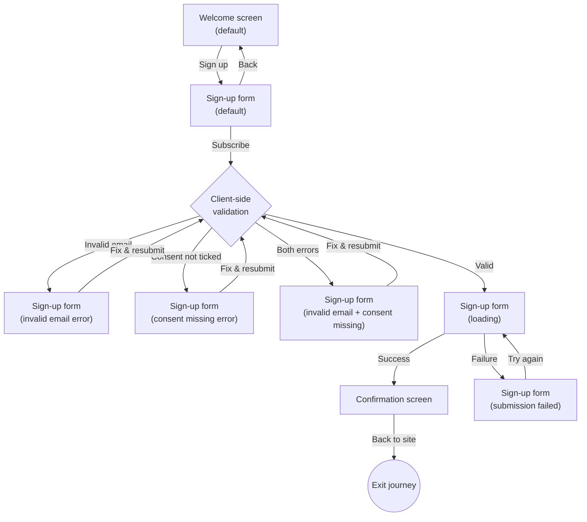

# Newsletter sign-up journey — Structure

## Personas

### First-time visitor (primary)

A person browsing the product's public site who wants to hear about new releases but does not want to create an account. They need a low-commitment way to stay informed — just an email address, nothing more.

**Needs:** Quick sign-up with minimal friction; clear understanding of what they are signing up for and how often they will be contacted; confidence their consent is explicit and revocable.

**Pain points:** The only current option is creating a full account, which is more commitment than they want.

### Returning visitor

A person who already signed up for the newsletter and lands on the sign-up page again (via bookmark, link, or browsing). They may or may not remember they already signed up.

**Needs:** Not be confused or alarmed if they submit the same address a second time.

**Pain points:** Being told "you already signed up" leaks whether an address is on the list. The journey must treat a duplicate submission identically to a new one.

## User interaction

## Screen inventory

| Screen | Purpose | Main elements | States |
|---|---|---|---|
| Welcome | Explain the newsletter (new releases, at most once a month) and invite the visitor to sign up | Headline; short description of the newsletter; **"Sign up"** primary button | **default** — standard copy. **empty** — no release announced yet; the copy still invites the sign-up (content variant, same layout) |
| Sign-up form | Collect the visitor's email address and explicit consent | Email address field; consent checkbox with label *"Send me the product newsletter. I can unsubscribe at any time."* (never pre-ticked); **"Subscribe"** primary button; back link to Welcome | **default** — empty form, ready for input. **invalid email** — inline error beside the email field. **consent missing** — inline error beside the checkbox. **loading** — spinner or equivalent; Subscribe button disabled. **submission failed** — banner or inline message saying sign-up did not go through; input preserved; Subscribe enabled to retry |
| Confirmation | Tell the visitor the sign-up request was received and to check their inbox | Confirmation headline; the email address they submitted; instruction to check inbox; **"Back to site"** link | **default** |

## Open branches

None. The story, the PRD and the acceptance criteria are aligned and cover all paths. No ambiguity requires a designer decision before prototyping can begin.
