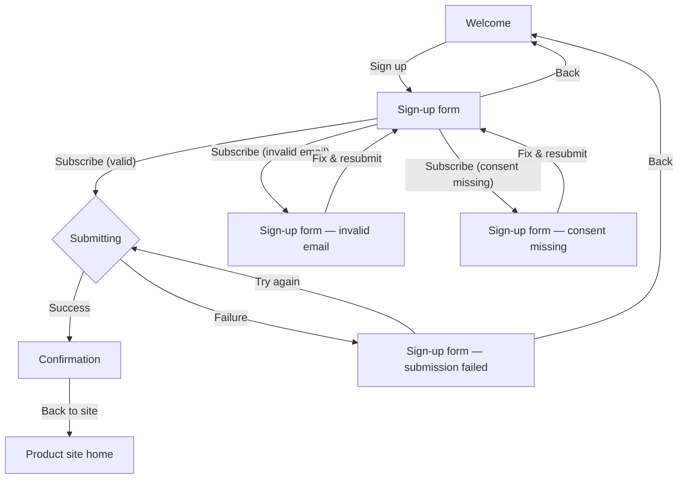

# Newsletter sign-up — Structure

## Personas

### First-time visitor (primary)

- **Who**: A person visiting the product's public site for the first time who is interested in the product but not ready to create an account.
- **Need**: Stay informed about new releases with minimal effort and commitment.
- **Pain point**: The only way to hear about releases today is to create an account, which they do not want to do.

### Returning visitor

- **Who**: A person who has visited before and may have already signed up for the newsletter, returning to the same page.
- **Need**: Sign up if they haven't, or not be penalised if they submit the same address again.
- **Pain point**: Being told their address is already on the list would leak subscription status; the journey must treat a duplicate submission identically to a new one.

## User interaction

## Screen inventory

| Screen | Purpose | Main elements | States |
|---|---|---|---|
| **Welcome** | Explain the newsletter and invite the visitor to sign up. | Headline; short description (new releases, at most once a month); "Sign up" primary button. | **Default** — standard copy and CTA. |
| **Sign-up form** | Collect email address and explicit consent. | Email input field; consent checkbox with label ("Send me the product newsletter. I can unsubscribe at any time."); "Subscribe" primary button; "Back" link to Welcome. | **Default** — empty form, ready for input. **Invalid email** — inline error beside email field ("Enter a valid email address."). **Consent missing** — inline error beside checkbox ("Consent is required to subscribe."). **Loading** — spinner or equivalent on the "Subscribe" button; button disabled; fields read-only. **Submission failed** — banner or inline message ("Something went wrong. Please try again."); visitor's input preserved; "Subscribe" button re-enabled. |
| **Confirmation** | Tell the visitor to check their inbox. | Confirmation message naming the submitted email address ("We sent a confirmation email to {email}."); "Back to site" link. | **Default** — single state. |

## Open branches

None. The story, the PRD and the functional requirements are consistent and complete; no decision requires designer input before the journey can be prototyped.
