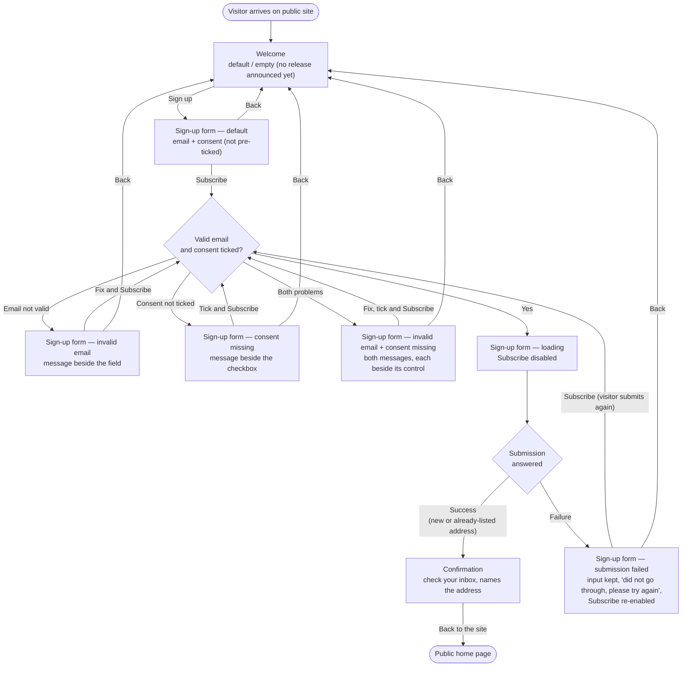

# Structure — Newsletter sign-up journey

Story: 20261103-081451Z Newsletter sign-up page. Three screens — Welcome, Sign-up form, Confirmation — on the public site, desktop and mobile. No account, no sign-in.

## Personas

| Persona | Who | Needs | Pain points |
|---|---|---|---|
| First-time visitor (primary) | Visits the public site for the first time and wants to hear about new releases | Sign up with only an email address; know what they get (new releases, at most once a month); finish in three screens, on desktop or phone | Today the only option is creating an account, which most visitors don't want |
| Returning visitor | Signed up before and comes back to the page | Can go through the same journey again without a problem | Must not be told whether their address is already on the list; sees the same Confirmation as anyone else |

## User interaction

## Screen inventory

| Screen | Purpose | Main elements | States |
|---|---|---|---|
| Welcome | Explain the newsletter and invite the visitor in (FR1) | Heading; copy: new releases, at most once a month, no account needed; primary action "Sign up" | **default**: copy may reference the latest release; **empty**: no release announced yet — copy still invites the sign-up; loading / error: n/a |
| Sign-up form | Collect email and explicit consent, validate, submit (FR2–FR5) | Email field with label; consent checkbox, unticked, with full wording "Send me the product newsletter. I can unsubscribe at any time."; primary action "Subscribe"; "Back" to Welcome; inline error text beside each control; form-level failure message | **default**: empty field, unticked box; **error — invalid email**: message beside the field, input kept; **error — consent missing**: message beside the checkbox, email kept; **error — both**: both messages shown together, each beside its control; **loading**: progress indicator on Subscribe, button disabled, input kept; **error — submission failed**: input kept, message "Your sign-up did not go through. Please try again.", Subscribe re-enabled — no automatic re-submit, the visitor presses Subscribe themselves; empty: n/a |
| Confirmation | Tell the visitor to confirm via their inbox (FR6) | Heading; "Check your inbox to confirm" copy naming the submitted address; action "Back to the site" → public home page | **default** only — identical for new and already-listed addresses; loading / error / empty: n/a |

All screens: fit a phone-width viewport with no horizontal scrolling; controls (field, checkbox with its label, buttons, links) sized for touch.

## Open branches

None. Resolved with the designer:

1. Invalid email and missing consent at once → both messages show together, each beside its control.
2. After a failed submission → no automatic re-submit; the input is kept and Subscribe is re-enabled so the visitor submits again.
3. "Back to the site" on Confirmation → the public home page.
