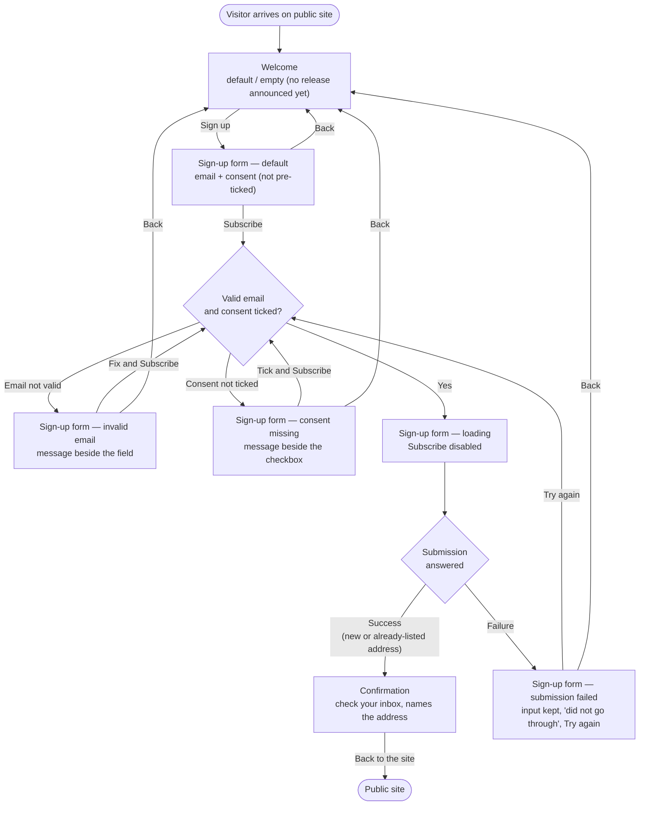

# Structure — Newsletter sign-up journey

Story: 20261103-081451Z Newsletter sign-up page. Three screens — Welcome, Sign-up form, Confirmation — on the public site, desktop and mobile. No account, no sign-in.

## Personas

| Persona | Who | Needs | Pain points |
|---|---|---|---|
| First-time visitor (primary) | Visits the public site for the first time and wants to hear about new releases | Sign up with only an email address; know what they get (new releases, at most once a month); finish in three screens, on desktop or phone | Today the only option is creating an account, which most visitors don't want |
| Returning visitor | Signed up before and comes back to the page | Can go through the same journey again without a problem | Must not be told whether their address is already on the list; sees the same Confirmation as anyone else |

## User interaction

## Screen inventory

| Screen | Purpose | Main elements | States |
|---|---|---|---|
| Welcome | Explain the newsletter and invite the visitor in (FR1) | Heading; copy: new releases, at most once a month, no account needed; primary action "Sign up" | **default**: copy may reference the latest release; **empty**: no release announced yet — copy still invites the sign-up; loading / error: n/a |
| Sign-up form | Collect email and explicit consent, validate, submit (FR2–FR5) | Email field with label; consent checkbox, unticked, with full wording "Send me the product newsletter. I can unsubscribe at any time."; primary action "Subscribe"; "Back" to Welcome; inline error text beside each control; form-level failure message with "Try again" | **default**: empty field, unticked box; **error — invalid email**: message beside the field, input kept; **error — consent missing**: message beside the checkbox, email kept; **loading**: progress indicator on Subscribe, button disabled, input kept; **error — submission failed**: input kept, "Your sign-up did not go through", "Try again"; empty: n/a |
| Confirmation | Tell the visitor to confirm via their inbox (FR6) | Heading; "Check your inbox to confirm" copy naming the submitted address; action "Back to the site" | **default** only — identical for new and already-listed addresses; loading / error / empty: n/a |

All screens: fit a phone-width viewport with no horizontal scrolling; controls (field, checkbox with its label, buttons, links) sized for touch.

## Open branches

Decided with the simplest option; confirm or change:

1. **Both validation errors at once** — if the email is invalid *and* consent is missing, the diagram shows one state per error; I assume both messages show together, each beside its control. Agree?
2. **"Try again" behaviour** — I assume it re-submits the kept input directly (re-running validation, then loading). The alternative is just dismissing the message so the visitor presses "Subscribe" again.
3. **Where "Back to the site" goes** — the sources say "a way back to the site" without naming a destination; I assume the public site's home page.
