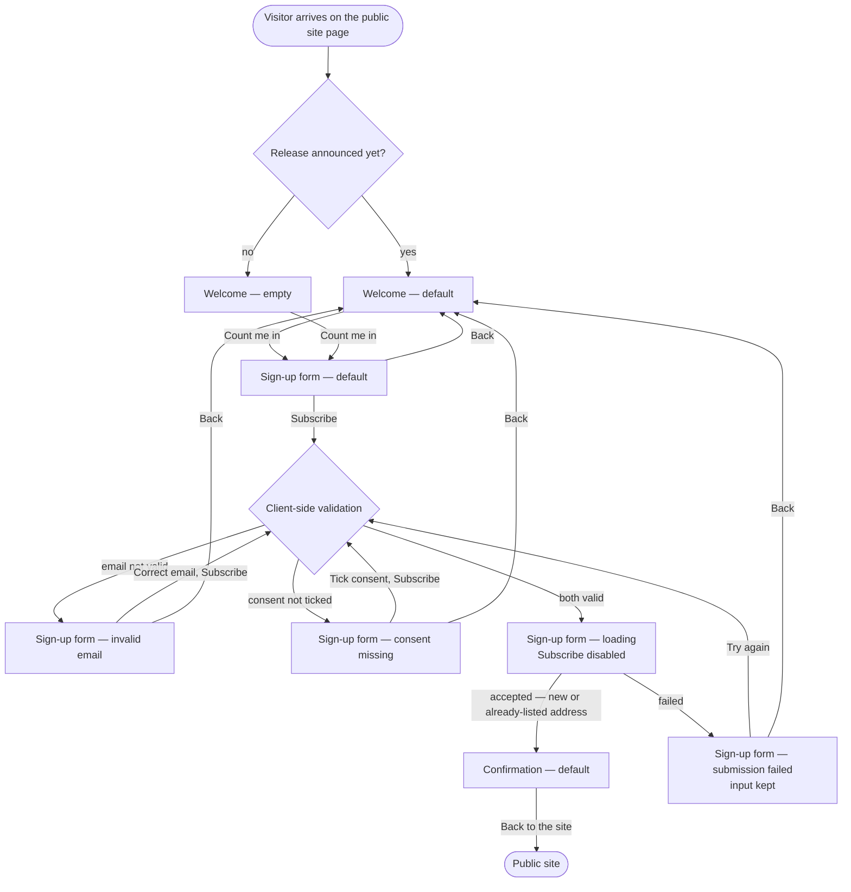

# Newsletter sign-up page — Structure

## Personas

### First-time visitor (main persona)

- **Who**: A visitor to the product's public site who has not signed up before.
- **Needs**: Hear about new releases (at most once a month) with just an email address — no account, no sign-in.
- **Pain points**: Today the only way to stay informed is to create an account, which most visitors do not want. They may arrive on a phone as often as on a desktop.

### Returning visitor

- **Who**: A visitor who signed up before and comes back to the page.
- **Needs**: Go through the same journey without friction; if they submit the same address again, land on the Confirmation screen as usual.
- **Pain points**: Being told "you are already subscribed" would reveal list membership — the journey must never do that.

## User interaction

All screens are laid out for desktop and phone width; the phone layout changes the layout only, never the path.

## Screen inventory

| Screen | Purpose | Main elements | States |
|---|---|---|---|
| **Welcome** | Say what the newsletter is and invite the visitor in (FR1) | Heading "Join the Otter Club"; tagline "One email a month. Zero spam."; latest release teaser (when one exists); primary button "Count me in" — all copy word for word from the designer's mockup | **Default** — with the latest release mentioned. **Empty** — no release announced yet; heading, tagline and "Count me in" unchanged. No loading or error state. |
| **Sign-up form** | Collect an email address and explicit consent (FR2–FR5) | Email field with label; consent checkbox, unticked by default, with full wording "Send me the product newsletter. I can unsubscribe at any time."; primary button "Subscribe"; "Back" link to Welcome | **Default** — empty field, unticked checkbox. **Error: invalid email** — message in words beside the email field, input kept. **Error: consent missing** — message beside the checkbox asking for consent, email kept. (Both messages show together if both fail.) **Loading** — Subscribe shows progress and is disabled; inputs locked. **Error: submission failed** — message that the sign-up did not go through, all input kept, "Try again" action. |
| **Confirmation** | Tell the visitor to check their inbox to confirm (FR6) | Heading; message naming the address the mail went to; "Back to the site" link | **Default** — identical for a new and an already-listed address. No loading, error or empty state. |
| **Public site** (exit) | Where "Back to the site" leads; existing page, not designed in this story | — | — |

Mobile (Scenario 6): every screen fits a phone width without horizontal scrolling; email field, checkbox (with its label as tap target), buttons and links are sized for touch.

## Open branches

1. **Where does "Back to the site" lead?** The sources say "a way back to the site" without naming the page. Assumed: the public site home page.
2. **Both validation errors at once.** If the email is invalid *and* consent is missing, the sources do not say whether one or both messages appear. Assumed: both messages show together, each beside its control, so the visitor fixes everything in one pass.
3. **What the Welcome screen shows when a release exists.** The "empty" state implies the default mentions a release, but the sources do not say how. Assumed: one line naming the latest release; the empty state replaces it with copy about upcoming releases.
4. **Email field on the Welcome mockup.** The mockup shows an email field (placeholder "you@example.com") on the Welcome screen, but the story and the change request keep a separate form screen with the email and consent. Assumed: Welcome takes only the mockup's heading, tagline and button; the email field stays on the Sign-up form, so the journey keeps three screens and consent always sits beside the email.
5. **"New releases" on Welcome.** FR1 asks the Welcome screen to say the newsletter is about new releases; the mockup tagline says only "One email a month. Zero spam." Assumed: the release teaser line (branch 3) and the empty-state copy carry the "new releases" message, and the tagline stays word for word.
