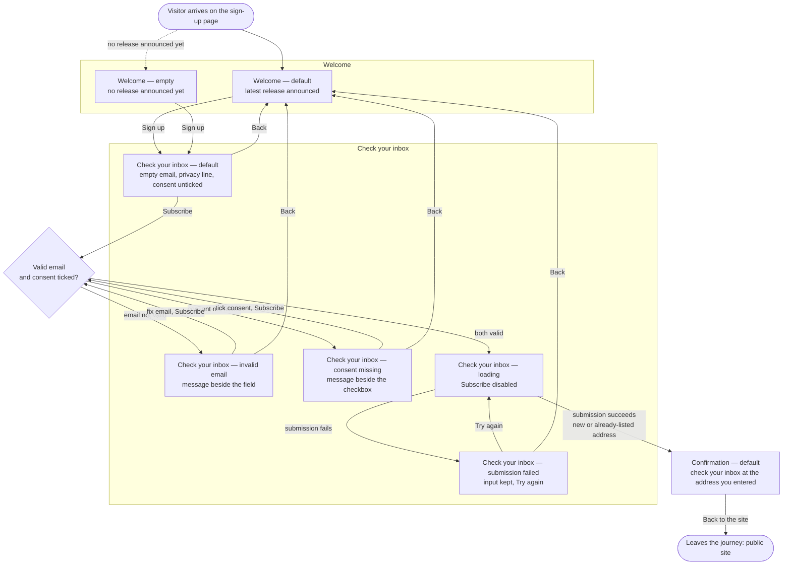

# Newsletter sign-up page — Structure

The visitor gets from the Welcome screen through the form screen, named **Check your inbox**, to the Confirmation screen, with no account. There are three screens. The form has five states, and every screen has a desktop layout and a phone layout.

> Change applied (B4-live): the second screen, the form screen, is renamed **Check your inbox**, and a privacy line sits under its email field. See open branch 1 about the name.

## Personas

### First-time visitor (main persona)

- **Who**: Someone on the product's public site for the first time who wants to hear about new releases.
- **Needs**: Sign up with only an email address and an explicit consent, quickly, on desktop or on a phone. Know what they are signing up for (new releases, at most once a month) and what happens next (check the inbox to confirm).
- **Pain points**: Today the only way to hear about releases is to create an account, and most visitors do not want one. A form that loses what they typed when something goes wrong.

### Returning visitor

- **Who**: Someone who signed up before and comes back to the page.
- **Needs**: Go through the same journey without friction. If they submit the same address again, they see the Confirmation screen again.
- **Pain points**: No new pain point. The design constraint is privacy: nothing in the journey may reveal whether an address is already on the list. Duplicate and new sign-ups look the same.

## User interaction

Notes on the diagram:
- If the email is not valid *and* the consent is not ticked, both messages show at once. The Check your inbox screen shows each control's message beside it (FR3).
- The privacy line under the email field stays in every state of the Check your inbox screen. The invalid-email message sits beside the field, so it does not replace the privacy line.
- "Back" goes to the Welcome screen variant the visitor came from.
- `Entry` and `Exit` are the edges of the journey, not screens. The public site itself is out of scope.
- Every screen and state needs a desktop layout and a phone layout (Scenario 6). The flow is the same on both.

## Screen inventory

| Screen | Purpose | Main elements | States |
|---|---|---|---|
| **Welcome** | Says what the newsletter is and invites the visitor to sign up (FR1). | Headline. Short description: new releases, at most once a month, no account needed. One primary action, "Sign up". | **Default**: the copy can mention the latest release. **Empty**: no release announced yet; the copy still invites the sign-up and the "Sign up" button stays the same. Loading and error: not applicable, the screen is static. |
| **Check your inbox** (the form screen) | Collects an email address and an explicit consent, and submits them (FR2–FR5). | Email field with a visible label. A **privacy line directly under the email field** (proposed wording in open branch 2). Consent checkbox, unticked by default, with the full wording beside it: "Send me the product newsletter. I can unsubscribe at any time." One primary action, "Subscribe". A "Back" link to Welcome. A place for a message beside each control. A form-level message area for the failed submission. | **Default**: email empty, consent unticked, privacy line shown. **Invalid email**: a message in words beside the field; the input and the privacy line are kept. **Consent missing**: a message beside the checkbox asking for the consent; the email is kept. Both messages can show together. **Loading**: Subscribe shows progress and cannot be pressed again; the input stays visible. **Submission failed** (error): says the sign-up did not go through, keeps the email and the consent as entered, and offers "Try again". Empty: not applicable. |
| **Confirmation** | Tells the visitor to check their inbox to confirm (FR6). | Message to check the inbox to confirm. The address the mail was sent to. One action back to the site. | **Default** only. The copy is identical for new and already-listed addresses, so it reveals nothing about list membership. |

Phone layout for every screen: a single column that fits the screen width with no horizontal scrolling. The email field, the privacy line, the checkbox and its label, and every button are large enough to tap or read. The full consent wording wraps. It is never cut short.

## Open branches

In each case below I chose the simplest option that keeps the journey complete. Confirm or change these before the Prototype step:

1. **Which screen should be called "Check your inbox"?** I applied the change request as written and renamed the second screen, the form. That phrase is also what the Confirmation screen tells the visitor (FR6), and a form titled "Check your inbox" could suggest a mail was already sent. If you meant the Confirmation screen, the title moves there and the form goes back to "Sign-up form". Nothing else in the journey changes.
2. **The privacy line's wording.** None of the sources give it. I propose: "We only use your address to send the newsletter. We never share it." It sits under the email field, above the consent checkbox, as quiet supporting text. It is not a second consent.
3. **Where "Back to the site" lands on the Confirmation screen.** The story only says "a way back to the site". I chose the public site's home page.
4. **What the Welcome screen says in each state.** I assumed the default state can mention the latest release, and the empty state uses general copy ("be the first to hear when we release"). Both keep the same "Sign up" action.
5. **When validation runs.** I chose to validate when the visitor presses "Subscribe" (FR3: "before it submits"), with no checking while they type. A message clears once the visitor fixes that field and submits again.
