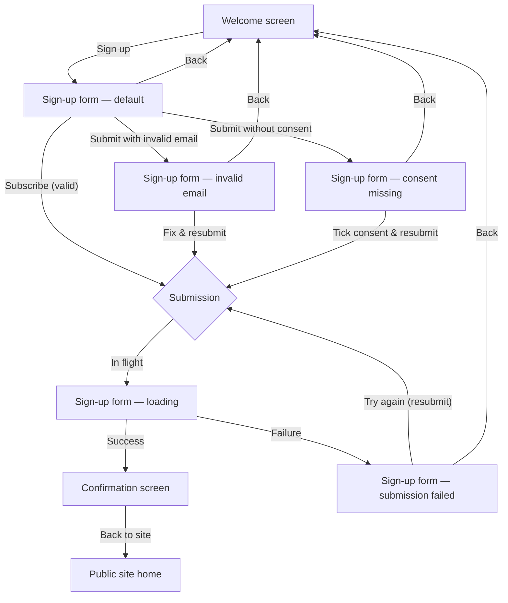

# Newsletter sign-up — Structure

## Personas

### First-time visitor

- **Who**: Someone landing on the public site for the first time, curious about the product.
- **Need**: Hear about new releases without creating an account — low commitment, just an email address.
- **Pain point**: The only way to stay informed today is to create an account, which most visitors do not want.

### Returning visitor

- **Who**: Someone who visited the sign-up page before — they may or may not have already subscribed.
- **Need**: Sign up if they have not yet, or revisit the page without being told they already subscribed (no information leak about list membership).
- **Pain point**: None unique beyond the first-time visitor; the journey must treat a duplicate submission the same as a new one.

## User interaction

## Screen inventory

| Screen | Purpose | Main elements | States |
|---|---|---|---|
| **Welcome** | Explain the newsletter and invite sign-up | Headline, short description (new releases, at most once a month), primary button "Sign up" | Default |
| **Sign-up form** | Collect email and explicit consent | Email field, consent checkbox with label ("Send me the product newsletter. I can unsubscribe at any time."), primary button "Subscribe", back link | Default, Invalid email (inline error beside field), Consent missing (inline error beside checkbox), Loading (spinner / disabled button), Submission failed (banner error, input preserved, try-again action) |
| **Confirmation** | Tell visitor to check inbox | Confirmation message naming the submitted email address, link back to site | Default |

## Open branches

None. The story, PRD and acceptance criteria fully specify the personas, screens, states and branching. No decisions remain that require designer input before prototyping.
