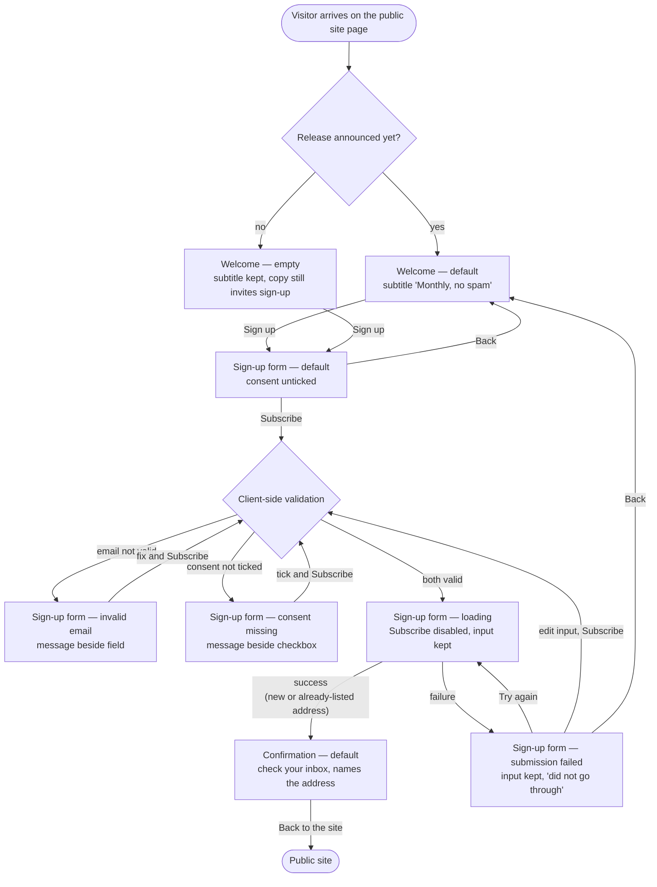

# Structure — Newsletter sign-up page

Three screens, no account: `Welcome` → `Sign-up form` → `Confirmation`. Every screen is designed for desktop and phone (fits the width, no horizontal scrolling, tap-sized controls).

## Personas

| Persona | Who | Needs | Pain points |
|---|---|---|---|
| **First-time visitor** (main) | Someone on the product's public site for the first time who wants to hear about new releases | Sign up with just an email address; know what they are signing up for (new releases, at most once a month); be told clearly what is wrong if the form rejects their input; use it on a phone as easily as on a desktop | Today the only way to hear about releases is to create an account, which they do not want; losing what they typed when something fails |
| **Returning visitor** | Someone who signed up before and comes back to the page | Submit again without friction and get the same outcome | Must not be told (or shown) whether their address is already on the list — they see the Confirmation screen again, exactly like a new sign-up |

## User interaction

When both checks fail, the invalid-email and consent-missing messages show together, each beside its own control.

## Screen inventory

| Screen | Purpose | Main elements | States |
|---|---|---|---|
| **Welcome** | Explain what the newsletter is and invite the visitor in (FR1) | Heading; subtitle "Monthly, no spam" directly under the heading; short copy: new releases, at most once a month, no account needed; one primary action "Sign up" | **default** — copy can reference the latest release; **empty** — no release announced yet, heading and subtitle unchanged, copy still invites the sign-up; loading — n/a; error — n/a |
| **Sign-up form** | Collect an email address and explicit consent, validate before submitting (FR2–FR5) | Email address field with label; consent checkbox, never pre-ticked, with the full wording "Send me the product newsletter. I can unsubscribe at any time."; primary action "Subscribe"; a way back to Welcome; inline error text beside each control; form-level failure message with "Try again" | **default** — empty field, consent unticked; **error: invalid email** — message in words beside the field, input kept; **error: consent missing** — message beside the checkbox asking for consent, input kept; **loading** — loading indicator, "Subscribe" disabled, input kept; **error: submission failed** — "Your sign-up did not go through" plus "Try again", all input kept; empty — n/a |
| **Confirmation** | Tell the visitor to check their inbox to confirm (FR6) | Heading; "Check your inbox to confirm" copy naming the address the mail went to; a way back to the site | **default** — the same for new and already-listed addresses; loading / error / empty — n/a |

## Open branches

Decided with the simplest option; confirm or change:

1. **Destination of "Back to the site" on Confirmation** — the sources say "a way back to the site" without naming a page. Assumed: the public site's home page. Should it go somewhere else (e.g. the page the visitor came from)?
2. **When validation runs** — the sources require validation before submit. Assumed: on "Subscribe" only; errors then clear as the visitor fixes each control. Should the email field also validate when the visitor leaves it?
3. **What the empty Welcome state looks like** — the sources only say the copy still invites the sign-up when no release is announced. Assumed: the default layout without the latest-release mention. Is there release content on the default Welcome screen that the empty state replaces?
