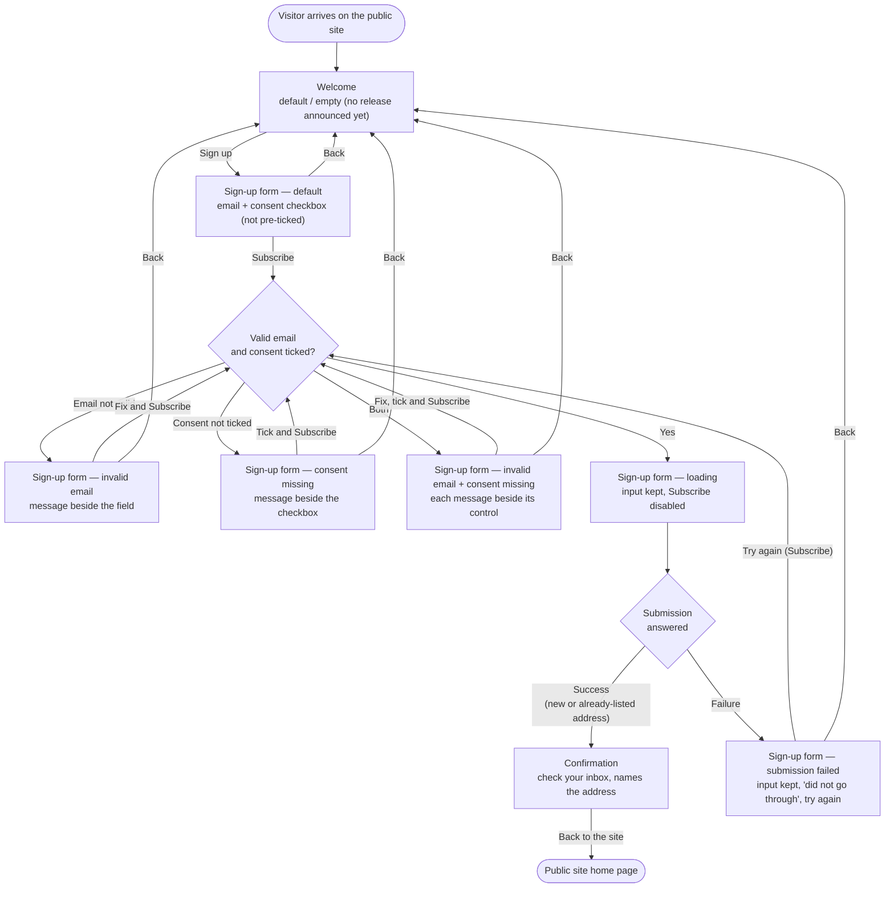

# Structure — Newsletter sign-up journey

Story: DESIGNCHEC-1 — Newsletter sign-up page. Three screens on the public site (Welcome, Sign-up form, Confirmation), desktop and mobile. No account, no sign-in. Out of scope: the newsletter email, unsubscribing, preferences.

The Sign-up form exists today (attached `harbour-signup-today.png`): it is rebuilt from that screenshot and keeps its look. Welcome and Confirmation are new and use the same site look.

## Personas

| Persona | Who | Needs | Pain points |
|---|---|---|---|
| First-time visitor (primary) | Visits the public site for the first time and wants to hear about new releases | Sign up with only an email address and an explicit consent; know what they get (new releases, at most once a month); finish in three screens on desktop or phone; be told what is wrong before submitting | Today the only way to hear about releases is creating an account, which most visitors do not want |
| Returning visitor | Signed up before and comes back to the page | Can go through the same journey again without friction | Must not learn whether their address is already on the list — they see the same Confirmation as anyone else |

## User interaction

## Screen inventory

| Screen | Purpose | Main elements | States | Based on |
|---|---|---|---|---|
| Welcome | Explain the newsletter and invite the visitor in (FR1) | Site header and footer as on the existing form; heading; copy: new releases, at most once a month, no account needed; one primary action "Sign up" | **default**: copy may reference the latest release; **empty**: no release announced yet — copy still invites the sign-up; loading / error: n/a | new |
| Sign-up form | Collect email and explicit consent, validate, submit (FR2–FR5) | **Kept from today**: burgundy site header with title and nav (Stories, Archive, Subscribe), cream page, serif type, burgundy heading and one-line intro, bordered white form card, "Your email" label and field, yellow uppercase primary button, "Past dispatches" side column, footer line. **Added by this story**: consent checkbox under the field, unticked, with the full wording "Send me the product newsletter. I can unsubscribe at any time."; primary button labelled "Subscribe" (FR2); "Back" link to Welcome; inline error text beside each control; failure message inside the card | **default**: empty field, unticked box; **error — invalid email**: message beside the field, input kept; **error — consent missing**: message beside the checkbox, email kept; **error — invalid email + consent missing**: both messages, each beside its control; **loading**: progress indicator on Subscribe, button disabled, input kept; **error — submission failed**: input kept, "Your sign-up did not go through. Please try again.", Subscribe re-enabled as the retry; empty: n/a. Mobile: side column stacks below the card, card fills the width | harbour-signup-today.png |
| Confirmation | Tell the visitor to confirm via their inbox (FR6) | Site header and footer as on the existing form; heading; "Check your inbox to confirm" copy naming the submitted address; action "Back to the site" | **default** only — identical for new and already-listed addresses; loading / error / empty: n/a | new |

All screens: fit a phone-width viewport with no horizontal scrolling; field, checkbox with its label, buttons and links sized for touch.

No checkout renders the form: the spec repository holds a Python utilities package and a JSON-only guestbook API, so the screenshot is the only source.

## Open branches

None. Decided with the simplest option, per the designer:

1. Invalid email and missing consent at once → both messages show together, each beside its control.
2. Retry after a failed submission → input kept, Subscribe re-enabled; the visitor presses it again (no automatic re-submit, no extra button).
3. "Back to the site" on Confirmation → the public site home page.
4. Where today's form and the story differ, the story's wording wins and the look stays: the button reads "Subscribe" (today "Sign me up"), and the intro states the story's cadence, at most once a month (today "One letter a week").
