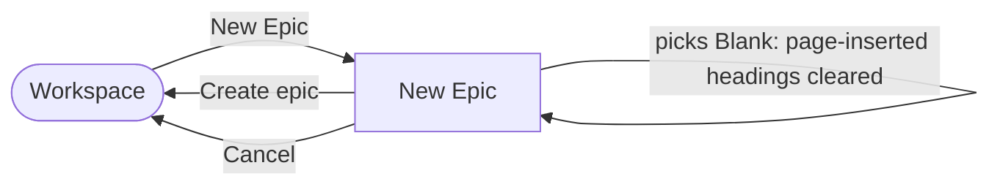

# E2EDSG-1 — New Epic page offers a starting outline: structure

## What changes
- Can do after: pick a starting outline (Blank, New capability, Change to an existing screen) so the description box opens with that outline's headings.
- Screens added: none.
- Screens changed: `New Epic` — a one-choice outline picker under the description box, and an on-the-spot confirmation before replacing typed text.
- Screens that only show the change in their components: none. Every other screen (the workspace the page is opened from and returns to) stays as it is today, drawn rounded.
- Devices: desktop, landscape, 1280×720 (the Playwright `Desktop Chrome` device both test projects use; the page has no phone layout).

## Personas
- **Product owner opening an epic** — needs a description the agents can work from; today the description box starts empty, so they must remember which headings each kind of epic needs and any typed text must never be silently lost.

## User interaction

## Screen inventory
| screen | purpose | main elements | states | based on |
|---|---|---|---|---|
| New Epic | name and describe a new epic, now from a starting outline | outline choice under the description box (Blank, New capability, Change to an existing screen; single-select radio group); description box filled with the outline's headings; inline confirmation (message, Replace text, Keep my text) | default (Blank selected, box empty); outline selected (New capability, headings in the box); confirming replace (typed text, inline confirmation showing) | harel-pdlc-frontend-539650d6a7/src/halo/workspace/NewEpicPage.tsx |

## Open branches
- **Outline headings** — the story names the outlines, not their headings. Assumed: New capability → Problem, Users, What they can do, Out of scope; Change to an existing screen → Screen today, What changes, Why, Out of scope; easy to reword later.
- **What counts as the person's own text** — Assumed: any text that differs from the headings the page inserted (edited headings included) is the person's, so switching outline asks first and Blank clears only unedited page headings; this is the conservative reading that never loses typed text.
- **Confirmation form** — "on the spot" read as an inline confirmation right under the outline choice, not a modal `HaloDialog`; Keep my text returns the selection to the previous outline.
- **Blank over typed text** — Assumed: picking Blank when the box holds the person's text changes nothing in the box and asks no confirmation, since Blank never removes typed text.

## Assumptions
Auto mode: the four open branches above were answered as stated and the run carried on with those answers.
