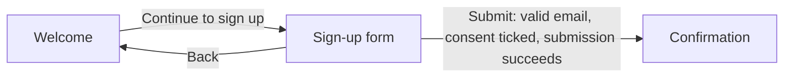

# E2EDSG-2 — Newsletter sign-up page — Structure

## What changes

- New: a visitor can sign up for the product newsletter with only an email address and explicit consent, no account needed.
- Screens added: `Welcome`, `Sign-up form`, `Confirmation`.
- Existing screens changed: none. Removed: none.
- Existing screens that only show the change in their components: none.
- Every other screen stays as it is today; no checkout holds a public site, so the journey has no rounded node.

Devices: desktop, landscape, 1280×800; phone, portrait, 390×844

## Personas

- **First-time visitor** — on the product's public site for the first time; wants to hear about new releases. Pain point: does not want to create an account just to stay informed, so the ask must be one field and one checkbox.

## User interaction

Invalid email, missing consent, submission in flight and submission failed keep the visitor on `Sign-up form`; they are its states, listed below.

## Screen inventory

| Screen | Purpose | Main elements | States | Based on |
|---|---|---|---|---|
| Welcome | explain the newsletter, invite the visitor in | headline, short description of what the newsletter sends (new releases), primary button "Continue" (teal #0F766E, full-width on phone) | default | new |
| Sign-up form | collect email address and explicit consent | email field with label, inline error beside field, unticked consent checkbox with label and inline error, primary button "Subscribe" (teal #0F766E, full-width on phone, tap-sized controls), back link to Welcome, form-level error banner with "Try again" | default, invalid email, consent missing, loading (button disabled, spinner), submission failed (input kept, try again) | new |
| Confirmation | tell the visitor to check their inbox | confirmation headline, message to check the inbox naming the submitted address | default | new |

## Open branches

- **Devices.** The story asks for desktop and mobile but names no viewport and no product screen exists to read one from; the document assumes the defaults desktop 1280×800 landscape and phone 390×844 portrait, the smallest choice that covers Scenario 6.
- **Entry and exit.** The sources name no page that links to `Welcome` and no next step after `Confirmation`; the document assumes `Welcome` is reached directly and `Confirmation` ends the journey, since the public site's other pages are not in any checkout and are out of scope.
- **Consent wording.** The exact consent text may follow a legal rule the sources do not give; the document assumes a plain placeholder ("Send me the product newsletter. I can unsubscribe at any time.") to be confirmed before release, since wording does not change the journey.

## Assumptions (auto mode)

- Is there a way back from the form to Welcome? — Yes, a back link; conservative, keeps the visitor in control.
- What does an email already subscribed see? — The same `Confirmation`; avoids revealing who is on the list and adds no screen.
- Where does the submission-failed message go? — A banner above the submit button with "Try again"; field-level errors stay beside their field (Scenarios 2, 3, 5).
- Primary button styling? — Teal #0F766E with white text, full-width on phone, per the standing brand rule.
