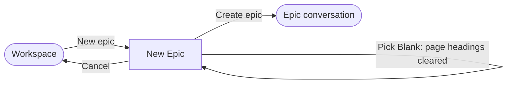

# E2EDSG-3 — New Epic page offers a starting outline: structure

## What changes

- New for the user: pick a starting outline (Blank, New capability, Change to an existing screen) so the description box opens with that outline's headings.
- Screens added: none.
- Screens changed: `New Epic` — an outline choice under the description box, and an on-the-spot confirmation before replacing typed text.
- Screens that only show the change in their components: none. Every other screen stays as it is today, drawn rounded where the journey passes through it.

Devices: desktop, landscape, 1280×720 (Playwright `Desktop Chrome`, the only device the product's tests use; the page has no phone layout).

## Personas

- **Product owner opening an epic** — needs a description the agents can work from; today starts from an empty box and has to remember which headings each kind of epic needs. Must never lose text they already typed.

## User interaction

## Screen inventory

| screen | purpose | main elements | states | based on |
|---|---|---|---|---|
| New Epic | name and describe a new epic, now from a starting outline | outline choice under the description box (Blank, New capability, Change to an existing screen; single choice); description box filled with the outline's headings; inline confirmation (Replace text / Keep my text) | default (Blank selected, box empty); outline selected (New capability, headings in box); confirm replace (own text in box, confirmation showing) | harel-pdlc-frontend-539650d6a7/src/halo/workspace/NewEpicPage.tsx |

## Open branches

- What headings each outline holds? Assumed: New capability — Problem, Users, What they can do, Out of scope; Change to an existing screen — Screen, What changes, Why, Out of scope; wording is the designer's to adjust.
- Is an outline's headings, once the PO edits them, still "the page's" text? Assumed no: any change to the inserted headings makes it the person's text, so Blank or another outline then asks to confirm (the safer reading — nothing typed is lost silently).
- How does the confirmation show "on the spot"? Assumed an inline message under the outline choice with Replace text and Keep my text, no modal; Keep my text restores the previous selection.
- Does the chosen outline get stored with the epic? Assumed no: only the description text is sent, as today, so no API change.

## Assumptions

Auto mode: the open branches above are answered with their assumed option; none changes scope, data, security or what others rely on.
