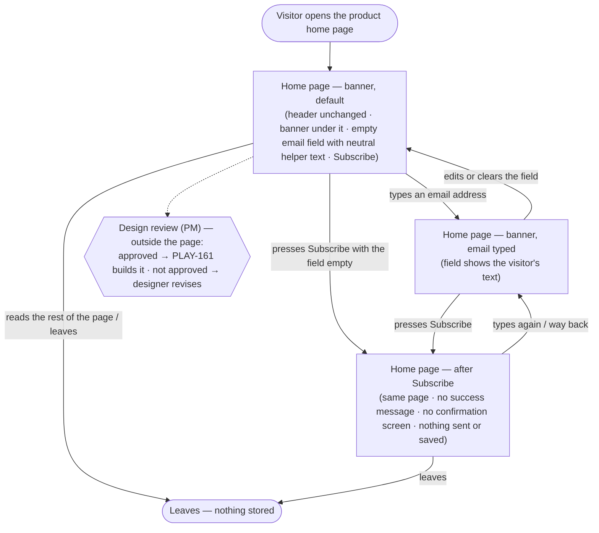

# PLAY-160 — Newsletter sign-up banner on the home page · Structure

Story: PLAY-160 "QA-20261108-S5 Design the newsletter sign-up banner on the home page" (epic PLAY-159). Unblocks PLAY-161, which builds this design as `qa/s5-banner.html`.

Scope: the existing home page plus **one** addition — a newsletter banner directly under the page header with an email field and a `Subscribe` button. Nothing else on the page changes (AC 2). There is no real sign-up: no success message, no confirmation screen (AC 3, PRD R4).

## Personas

| Persona | Source | Needs | Pain points |
| --- | --- | --- | --- |
| **Home page visitor** (primary user of the screen) | PRD §1.2 — working assumption, "for approval" by the PM (PRD §7) | Wants to hear about product updates; needs to see, right under the header, where to leave an email (PRD §3, US for PLAY-161). | Today the home page has no place to sign up (PRD §1.1). Risk RK1: types an email, presses Subscribe and believes they signed up, though nothing is registered. |
| **Product manager** (story owner, approver) | PLAY-160 story; PRD §3 step 3 | An approved design of the existing home page with the banner under the header, so development builds exactly that and does not guess (story). | RK2: the home page lives in no repository, so the build is made from a screenshot only and may not look like the real page. Must be able to recognise the banner as part of the home page. |
| **Designer** (supplies the input) | PRD §3 steps 1–2, §5 | Delivers a screenshot of the existing home page and designs the banner on top of it. | Without the screenshot there is nothing to design on and development waits (PRD §3 exception paths). |

The PM and designer act on the design, not on the page; the journey below is the visitor's journey through the page.

## User interaction

Notes on the diagram:
- There is no error, loading or empty-data state on this page: no backend, no network call, no data to load (PRD R4, §8). Pressing Subscribe on an empty field leads to the same "after Subscribe" state.
- There is deliberately no "Subscribed" / "Thanks" screen (AC 3). The journey ends on the home page itself.
- The dotted "Design review" node is the approval gate from PRD §3 step 3; it is not a screen and is not in the inventory.

## Screen inventory

| Screen | Purpose | Main elements | States (default / loading / error / empty) | Based on |
| --- | --- | --- | --- | --- |
| `Home page — banner, default` | First view: the existing home page with the newsletter banner under the header. | Existing header and every other part of the page exactly as in the screenshot; **new** banner directly under the header: email field (empty, neutral helper text only — no real address, PRD R5) and button labelled `Subscribe`. | Default: as described. Loading: none (static page). Error: none. Empty: this *is* the empty-field state. | `not found` — the home page is in no checkout (PRD §5, §8) and no screenshot is attached yet. The banner itself is `new`. Earlier newsletter sign-up designs under `play1-79db628f23/stories/*/design/` belong to other initiatives and are **not** a source (PRD §7). |
| `Home page — banner, email typed` | Show the field with visitor input, so PLAY-161 knows the filled look. | Same page; email field showing typed text; `Subscribe` button. | Default: filled field. Loading: none. Error: none designed (see open branch 2). Empty: back to the default screen when cleared. | `not found` (same page as above) · banner `new`. |
| `Home page — after Subscribe` | Make explicit what the page shows after the press: nothing that suggests a registration (RK1, AC 3). | Same page and banner; no success text, no toast, no confirmation screen. | Default: unchanged page. Loading: none. Error: none. Empty: field content after the press — see open branch 3. | `not found` (same page as above) · banner `new`. |

## Open branches

1. **Home page screenshot.** The story designs on the designer's screenshot of the existing home page, and none is attached yet. Can you attach it? Until then the page around the banner is `not found`, and header, layout, language/direction and visual style cannot be matched (RK2).
2. **Invalid email feedback.** The sources specify only an email field and a Subscribe button. Should the design show any "invalid email" hint (e.g. the browser's own email-field validation), or none at all? Default if you don't decide: no invalid-email state is designed.
3. **Field after Subscribe.** With no backend and no JavaScript, pressing Subscribe may simply keep the typed text or reload the page and clear it. Which should the design show? Default: the page looks unchanged and the typed text stays, with no message.
4. **Banner copy and viewports.** Should the banner carry a short heading or supporting line next to the field (sources give none), and is a mobile layout needed (sources mention none)? Default: field + `Subscribe` only, at the screenshot's viewport.
