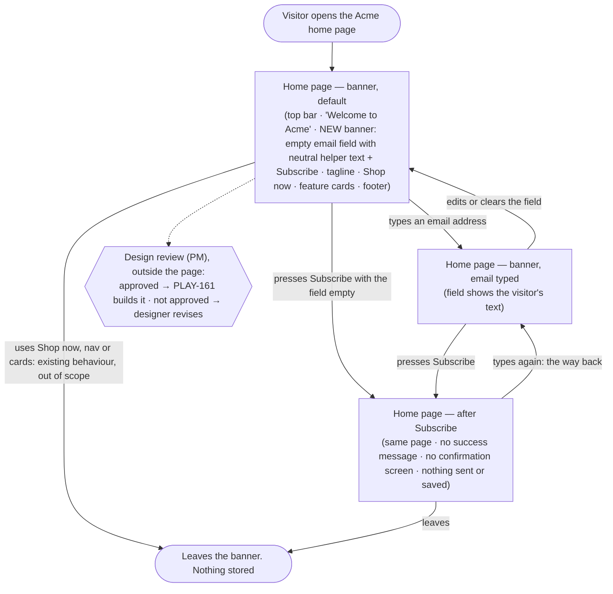

# PLAY-160 — Newsletter sign-up banner on the home page · Structure

Story: PLAY-160 "QA-20261108-S5 Design the newsletter sign-up banner on the home page" (epic PLAY-159). Unblocks PLAY-161, which builds this design as `qa/s5-banner.html`.

Scope: the existing Acme home page, as shown in the designer's screenshot `QA-20261108-S5-home-page`, plus **one** addition: a newsletter banner **directly under the hero heading "Welcome to Acme"** (designer answer). The banner holds an email field and a `Subscribe` button. Everything else stays exactly as in the screenshot (AC 2; designer: "keep everything else as it is"). There is no real sign-up, so the design has no success message and no confirmation screen (AC 3, PRD R4).

### The existing page (from the screenshot)

| Region | Content in the screenshot | Change |
| --- | --- | --- |
| Top bar | Dark-blue bar; "Acme" wordmark on the left; nav `Home` · `Products` · `About` · `Contact` on the right | none |
| Hero (white) | Heading "Welcome to Acme" → **[new banner goes here]** → tagline "Tools that make your day simpler." → orange `Shop now` button | banner inserted under the heading |
| Features (light grey) | Three white cards: "Fast delivery / Orders ship in 24 hours.", "Free returns / 30 days, no questions.", "Support / We answer within an hour." | none |
| Footer | "© 2026 Acme Inc." | none |

## Personas

| Persona | Source | Needs | Pain points |
| --- | --- | --- | --- |
| **Home page visitor** (primary user of the screen) | PRD §1.2: working assumption, pending PM approval (PRD §7) | Wants to hear about product updates. Needs to see where to leave an email, under the hero heading (PRD §3; PLAY-161 story). | Today the home page has no place to sign up (PRD §1.1). RK1: types an email, presses Subscribe and believes they signed up, though nothing is registered. |
| **Product manager** (story owner, approver) | PLAY-160 story; PRD §3 step 3 | An approved design of the existing home page with the banner in place, so development builds exactly that and does not guess (story). | RK2: the home page lives in no repository and is rebuilt from a screenshot only, so it must still read as the real Acme home page. |
| **Designer** (supplies the input) | PRD §3 steps 1–2, §5 | Delivers the home page screenshot (done: `QA-20261108-S5-home-page`) and designs the banner on it. | Every pixel outside the banner must match the screenshot (AC 2). |

The PM and the designer work on the design, not on the page. The journey below is the visitor's journey through the page.

## User interaction

Notes:
- The page has no loading, error or data-empty state. There is no backend, no network call and no data to load (PRD R4, §8). Pressing Subscribe with an empty field goes to the same "after Subscribe" state.
- There is deliberately no "Subscribed" or "Thanks" screen (AC 3). The journey ends on the home page.
- The dotted "Design review" node is the approval gate (PRD §3 step 3). It is not a screen, so it is not in the inventory.

## Screen inventory

| Screen | Purpose | Main elements | States (default / loading / error / empty) | Based on |
| --- | --- | --- | --- | --- |
| `Home page — banner, default` | First view: the existing Acme home page with the newsletter banner under the hero heading. | Unchanged: top bar (Acme, Home/Products/About/Contact), heading "Welcome to Acme", tagline, `Shop now`, three feature cards, footer. **New:** banner between the heading and the tagline, holding an email field (empty, neutral helper text only, no real address, R5) and a button labelled `Subscribe`. | Default: as described. Loading: none (static page). Error: none. Empty: this *is* the empty-field state. | `QA-20261108-S5-home-page` (attached screenshot) for the page; banner `new` |
| `Home page — banner, email typed` | Shows the filled field, so PLAY-161 knows what it looks like. | Same page; email field shows the typed text; `Subscribe`. | Default: filled field. Loading: none. Error: none designed (open branch 2). Empty: back to the default screen when cleared. | `QA-20261108-S5-home-page` for the page; banner `new` |
| `Home page — after Subscribe` | Makes explicit what the page shows after the press: nothing that suggests a registration (RK1, AC 3). | Same page and banner; no success text, no toast, no confirmation screen. | Default: unchanged page. Loading: none. Error: none. Empty: see open branch 3 for the field's content after the press. | `QA-20261108-S5-home-page` for the page; banner `new` |

No checkout renders this page (PRD §5, §8). Earlier newsletter designs under `play1-79db628f23/stories/*/design/` belong to other initiatives and are **not** a source (PRD §7).

## Open branches

1. **Exact position.** "Under the hero heading" is read literally: the banner goes between "Welcome to Acme" and the tagline "Tools that make your day simpler." Or do you want it under the whole hero block (after `Shop now`, above the feature cards)? Default if you don't decide: directly under the heading.
2. **Invalid email feedback.** Should the design show any "invalid email" hint (for example, the browser's own email-field validation), or none? Default: no invalid-email state is designed.
3. **Field after Subscribe.** With no backend and no JavaScript, pressing Subscribe may either keep the typed text or reload the page and clear it. Which should the design show? Default: the page looks unchanged, the typed text stays and no message appears.
4. **Banner copy and viewports.** Should the banner have a short heading or supporting line (the sources give none)? Is a mobile layout needed (the screenshot is desktop only)? Default: field + `Subscribe` only, at the screenshot's desktop width.
