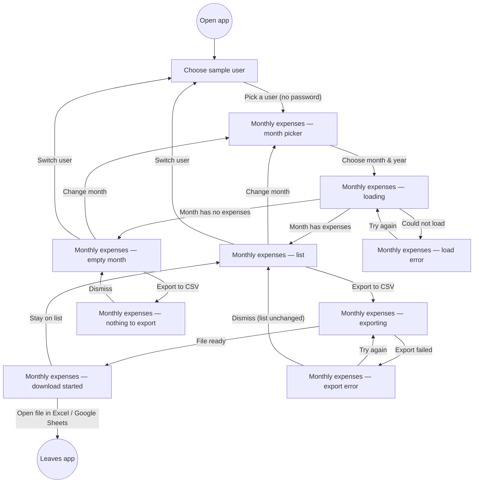

# Monthly expenses screen (מסך ההוצאות החודשיות) — Structure

Story: PLAY-94 · traces to R1, R2, R3, R4, R10 · process steps 1–4 (Epic PRD §3).
Read-only: no add / edit / delete, no filter, sort, totals or charts on any screen (AC 3).

## Personas

### Expense Tracker user who shares their month (primary)

A person who manages their personal expenses in the Expense Tracker and passes them on to an accountant or a partner (PRD §1.1, §1.2).

**Needs:**
- Pick themselves from the sample users, with no password (PRD §7, Q1).
- Choose a month and year and see exactly that month's expenses: date, description, category, amount (R1, R2).
- Find the export action right on that list and get a CSV download in one click (R4) — "reach the file without searching for how" (story).
- Be told plainly when a month has no expenses, both in the list and when trying to export (R3, R10).

**Pain points:**
- Today they copy expenses into a spreadsheet by hand (PRD §2).
- An empty file with no explanation would be confusing (PRD §1.1).
- Seeing someone else's expenses, or another month's, would make the shared file wrong (R5, R9).

### Product manager reviewing the prototype (secondary — acceptance only)

The PM walks the prototype from sample-user selection through month selection to export (AC 1–3). Not an end user of the app; they need every state of the journey reachable in the prototype, and nothing out of scope visible.

## User interaction

## Screen inventory

There are two screens. "Monthly expenses" is one screen. Each of its states below gets its own row so the prototype shows every one of them (AC 1, AC 2).

| Screen | Purpose | Main elements | States (default / loading / error / empty) |
| --- | --- | --- | --- |
| **Choose sample user** | Step 1: user identifies themselves without a password (PRD §7, Q1). | App title; short line explaining these are sample users; list of sample users (name, each one selectable). No password field, no sign-up. | Default: list of sample users. Loading / error / empty: not applicable — sample users are preloaded (see open branch 4). |
| **Monthly expenses — month picker** | Step 1: choose month and year (R1). | Header with the selected user's name + "Switch user"; month control and year control; no list yet. | Default: month and year controls ready, no month chosen yet (see open branch 1). |
| **Monthly expenses — loading** | Short wait between choosing a month and seeing it. | Header, month/year controls showing the selection, list area placeholder. | Loading. |
| **Monthly expenses — list** | Step 1א: show this user's expenses for the selected month only (R2, R9), and offer export (R4). | Header (user name, "Switch user"); month/year controls with current selection; table with columns **Date · Description · Category · Amount**, one row per expense; **Export to CSV** button. No add, edit, delete, filter, sort, totals or charts. | Default: rows shown. Long Hebrew or comma/quote descriptions must stay on one row, readable (PRD §3 exceptions). |
| **Monthly expenses — empty month** | Step 1א, empty: say the month has no expenses (R3). | Header; month/year controls; message "No expenses in ‹month year›" in place of the table; **Export to CSV** button still present (so R10 is reachable). | Empty. |
| **Monthly expenses — load error** | The list could not be shown. | Header; month/year controls; short understandable error message; "Try again". | Error. Not in the sources — added so the journey has no dead end (open branch 5). |
| **Monthly expenses — exporting** | Step 3: the file is being prepared. | List as in default; Export button shows progress and cannot be pressed twice. | Loading. |
| **Monthly expenses — download started** | Step 4: browser download of the CSV; the file name shows the month and year (R11, shown as a hint only). | List unchanged; short confirmation such as "Downloaded expenses-2026-10.csv". | Default (success). |
| **Monthly expenses — export error** | PRD §3 exception: export failed; the user can retry, the list does not change. | List unchanged; understandable error message; "Try again"; dismiss. | Error. |
| **Monthly expenses — nothing to export** | Export on an empty month: message instead of a file (R10, AC 2). | Empty-month message; notice "There are no expenses to export"; dismiss. No file is downloaded. | Empty. |

## Open branches

1. **Default month on entry.** After a user is picked, should the month picker show no month selected (so the PM sees an explicit "month & year selection" state, as drawn), or should it preselect the current month and go straight to the list? I drew the first; it's the simplest way to show all four states AC 1 asks for.
2. **Which months and years can be picked.** The sources say nothing about the range. Simplest option: any month in the years covered by the sample data, with no limit on future months. Future months would show the empty-month state.
3. **Currency on screen.** The R2 list columns are Date, Description, Category, Amount. Currency is a CSV column only (R6), but R7 says amounts must match the screen. Should the Amount column show the user's currency symbol (e.g. ₪)? I assumed yes, inside the Amount cell, with no separate column.
4. **Export button on an empty month.** I kept it enabled so that pressing it shows "There are no expenses to export" (R10, AC 2). The other option is a disabled button, but then the R10 message could never be shown. Please confirm enabled.
5. **List load error state.** The PRD only defines an error for a failed export. I added a load-error state with "Try again" so the journey has no dead end. Keep it or drop it?
6. **How messages appear** (download confirmation, export error, nothing to export): inline banner above the table, or toast. Left to the screens step; the journey is the same either way.
