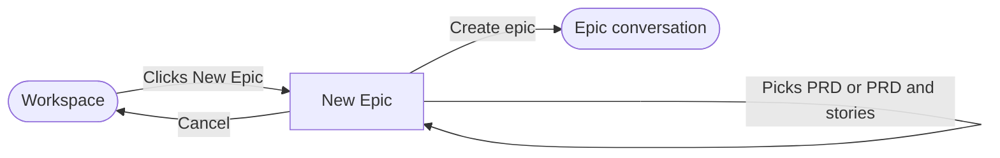

# PLAY3-11 — Structure: "Create drafts for" on New Epic

## What changes

- New: the product owner chooses on New Epic whether the agent drafts the PRD only or the PRD and the stories, instead of asking in the chat.
- Screens added: none.
- Screens changed: `New Epic` — one two-option choice "Create drafts for: PRD | PRD and stories" ("PRD" preselected) and one line under it naming what the agent drafts.
- Screens that only show the change in their existing components: none.
- Every other screen stays as it is today: `Workspace` (where New Epic is opened and Cancel returns) and `Epic conversation` (where Create epic lands) are drawn rounded.

## Personas

- **Product owner** — opens epics in Halo and wants the agent's first drafts to match their intent from the start; today they must ask in the chat for stories to be drafted with the PRD.

## User interaction

## Screen inventory

| Screen | Purpose | Main elements | States | Based on |
|---|---|---|---|---|
| New Epic | Name and open an epic, now choosing what the agent drafts first | added: "Create drafts for" two-option choice (PRD, PRD and stories); one line under it naming what the agent drafts for the selected option | default ("PRD" selected, line: PRD only); PRD and stories selected (line: PRD and stories) | harel-pdlc-frontend-539650d6a7/src/halo/workspace/NewEpicPage.tsx |

## Open branches

- Where on the page does the choice sit? Assumed: inside the rounded box, between the description (and attachment chips) and the action bar, since it is part of what the epic is created with; the pills, help text and everything else stay put.
- What does the line under the choice say? Assumed: "The agent drafts the PRD." for PRD and "The agent drafts the PRD and the stories." for PRD and stories — plain, and matching the acceptance criteria's wording.
