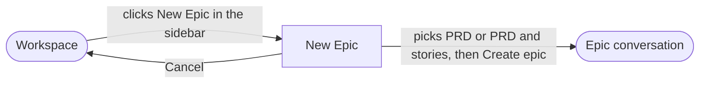

# PLAY3-12 — Structure: "Create drafts for" on New Epic

## What changes

- New for the user: on New Epic, choose whether the agent drafts the PRD only or the PRD and the stories, instead of asking in the chat.
- Screens added: none.
- Screens changed: `New Epic`, which gets a "Create drafts for: PRD | PRD and stories" choice ("PRD" selected at first) and one line under it saying what the agent will draft.
- Screens that only show the change in the components they have: none. Screens removed: none.
- Every other screen stays as it is today, and the diagram draws `Workspace` and `Epic conversation` rounded.

## Personas

- **Product owner (Halo user who opens epics):** wants the first drafts to match their intent from the start. Today, to get stories drafted alongside the PRD they have to ask the agent in the chat after the epic is created.

## User interaction

## Screen inventory

| screen | purpose | main elements | states | based on |
|---|---|---|---|---|
| New Epic | name the epic and choose what the agent drafts first | added: "Create drafts for" two-option choice (PRD, PRD and stories); one line under it naming what the agent drafts | default ("PRD" selected, line: PRD only); PRD and stories selected (line: PRD and stories) | harel-pdlc-frontend-539650d6a7/src/halo/workspace/NewEpicPage.tsx |

## Open branches

- Where on the page does the choice go? This document places it under the rounded box and above the Jira and Confluence pills, alongside the other settings for the epic, because the box itself (name, description, attachments, actions) is not meant to change.
- What does the line under the choice say? The document uses "The agent drafts the PRD." for PRD and "The agent drafts the PRD and the stories." for PRD and stories, since the story only asks that the line say what gets drafted.
- What kind of control is it? The document uses a two-option segmented control (one radio group), disabled while the epic is being created like the other fields. A two-option, single-choice pick reads most clearly that way, and it matches how the page already locks its fields.

## Assumptions (auto mode)

- Placement: under the box, above the pills. This leaves everything else on the page as it is today (AC 3).
- Helper line wording: as given under Open branches.
- Control: segmented radio group with "PRD" selected at first and disabled during "Creating…".
- No new states for loading, error or empty: the page's existing creation error and pending states are unchanged and are not redrawn.
