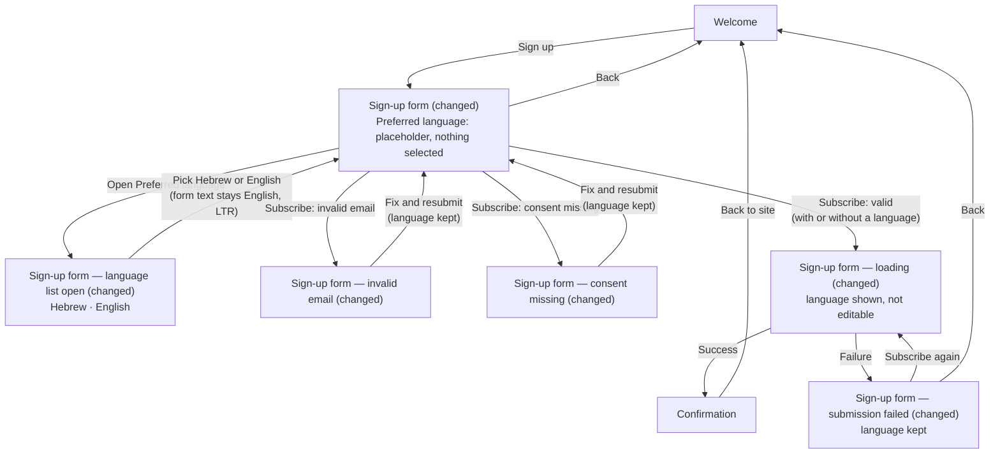

# Preferred language on the newsletter sign-up form — Structure

Story QA20261109-2 · Epic QA-20261109-S4 · Requirements R1–R9 · Risks RK1–RK4

**Baseline.** The design approved on 29 October 2026 for "Newsletter sign-up page" is story `2175b238` in the spec repository (structure, prototype and screens all approved on 2026-10-29). Every screen below is rebuilt from that baseline. The Sign-up form changes in two ways: it gets the new **Preferred language** field, and it uses the brand primary colour **#0a7f5a** (designer change request, brand-colour note QA-20261109-S4). Everything else stays as approved (R5, R6). See *Brand colour* under the screen inventory.

## Personas

### Visitor (end user of the form)

- **Who**: A visitor to the site who signs up for the newsletter with an email address (PRD §1.2).
- **Need**: To say which language they prefer, Hebrew or English, while signing up, without the sign-up taking longer or getting harder (PRD §2).
- **Pain points**: They should not have to pick the language again after an error or a failed submission (PRD §3). Picking "Hebrew" must not make them think the form will be translated or the choice saved (RK3, R7).

### Product manager (approver; the story's persona)

- **Who**: The person who approves the updated design and clicks through the prototype (PRD §1.2, story).
- **Need**: To see the new field working in the clickable prototype and in all ten form screens, so they can approve the design in one round (PRD §2).
- **Pain point**: Any change to a part that should have stayed the same means another review round (RK2).

### Developer (reader of the screens gallery)

- **Who**: The engineers who will later build the form from this design (PRD §1.2).
- **Need**: The field in the same position and with the same look in all five states, on desktop and mobile, so they can build it without guessing (R2).
- **Pain point**: Screens that disagree with each other lead to an inconsistent build (RK1).

## User interaction

Nodes marked **(changed)** get the new field and the brand colour. All other nodes, and every arrow, are the same as in the approved journey.

There is no error state for the language: Subscribe without a language follows the same arrows (Q2 working assumption). The approved prototype sends "Back to site" to Welcome. That stays the same.

## Screen inventory

Desktop and mobile versions are separate files in the baseline. Both are listed in **Based on**, and both get the same change (R2). All paths are under `play1-79db628f23/stories/2175b238/design/`.

| Screen | Purpose | Main elements | States | Based on |
|---|---|---|---|---|
| **Welcome** | Explain the newsletter and invite the visitor to sign up. **Unchanged** (R6). | Headline, short description, "Sign up" button. | Default only. | `play1-79db628f23/stories/2175b238/design/screens/welcome-default.html`, `…/screens/welcome-default-mobile.html`; prototype `…/prototype/welcome.html` |
| **Sign-up form** (changed) | Collect the email address, the preferred language (new, optional) and consent. | Heading "Sign up for the newsletter", intro text, email field, **new: "Preferred language" dropdown (label + neutral placeholder, e.g. "Select a language"; no option selected)**, consent checkbox, "Subscribe" button, "← Back" link. New field sits below the email field and above consent (Q4). | **Default**: the field shows its placeholder (Q1). Loading, error and empty states are the separate rows below. | `play1-79db628f23/stories/2175b238/design/screens/sign-up-form-default.html`, `…/screens/sign-up-form-default-mobile.html`; prototype `…/prototype/sign-up-form.html` |
| **Sign-up form — language list open** (changed) | Let the visitor pick a language in the prototype (R3). | Same form, with the dropdown's list open showing exactly two options: "Hebrew", "English" (Q3). After a pick, the field shows the chosen language, and the form's text and LTR direction stay the same (R7). | **Open**: interaction state, shown in the prototype only, not one of the ten gallery screens. | `play1-79db628f23/stories/2175b238/design/prototype/sign-up-form.html` (no list exists today; the list itself is new) |
| **Sign-up form — invalid email** (changed) | Show the existing email error. | Approved error state, plus the language field showing a selected language (R4). | **Error**: the existing "Enter a valid email address." under the email field, same text and position. | `play1-79db628f23/stories/2175b238/design/screens/sign-up-form-invalid-email.html`, `…/screens/sign-up-form-invalid-email-mobile.html` |
| **Sign-up form — consent missing** (changed) | Show the existing consent error. | Approved error state, plus the language field showing a selected language. | **Error**: the existing "Consent is required to subscribe." under the checkbox, same text and position. | `play1-79db628f23/stories/2175b238/design/screens/sign-up-form-consent-missing.html`, `…/screens/sign-up-form-consent-missing-mobile.html` |
| **Sign-up form — loading** (changed) | Show that the submission is in progress. | Approved loading state ("Subscribing…" with a spinner, email read-only, checkbox disabled), plus the language field showing the selected language, disabled like the other fields (R4). | **Loading**. | `play1-79db628f23/stories/2175b238/design/screens/sign-up-form-loading.html`, `…/screens/sign-up-form-loading-mobile.html` |
| **Sign-up form — submission failed** (changed) | Show the existing failure banner, with the visitor's input kept. | Approved failure banner, plus the language field showing the selected language, editable. | **Error**: the existing "Something went wrong and your sign-up did not go through. Please try again." | `play1-79db628f23/stories/2175b238/design/screens/sign-up-form-submission-failed.html`, `…/screens/sign-up-form-submission-failed-mobile.html` |
| **Confirmation** | Tell the visitor to check their inbox. **Unchanged** (R6). It does not mention the language. | Check icon, "Check your inbox", the submitted address, spam hint, "Back to site". | Default only. | `play1-79db628f23/stories/2175b238/design/screens/confirmation-default.html`, `…/screens/confirmation-default-mobile.html`; prototype `…/prototype/confirmation.html` |

**Empty state.** The form has no separate empty state. "Empty" is the Default state, where the email field shows its placeholder and the language field shows its neutral placeholder.

**Screens gallery** (`…/screens/index.html`) and **prototype index** (`…/prototype/index.html`): their text, layout and links stay the same (R6). Only the form screens they link to change.

### Brand colour (designer change request)

Source: attached note "QA-20261109-S4 brand colour". The brand primary is **#0a7f5a** (deep green). It replaces the approved blue `#2563eb` (`--color-primary` / `--color-link` in the baseline `tokens.css`) on the screens this story changes: the Sign-up form and all its states, on desktop and mobile, in the prototype and in the screens gallery.

| Element on the Sign-up form | Colour |
|---|---|
| "Subscribe" button background (`.btn-primary`) | #0a7f5a, with white text (contrast about 5.0:1 against white, which passes WCAG AA) |
| "← Back" link and any other link on the form (`--color-link`) | #0a7f5a |
| Focus ring of the new **Preferred language** dropdown | #0a7f5a |
| Focus ring of the email field and the consent checkbox's check colour, which use `--color-primary` today | #0a7f5a, so every focus ring on the form matches |
| Loading state's disabled "Subscribing…" button, and the hover shade | Green versions of the approved light and dark blues (see open branch 8) |

Everything else in `tokens.css` stays the same: error reds, greys, fonts and spacing. Welcome and Confirmation keep the approved colours (R6, scenario 10). See open branch 7.

**Third-party assets.** The new field uses the existing `tokens.css` and system fonts, with a native or CSS-drawn chevron. No new component, icon or font (R9).

## Open branches

These working assumptions come from the story's blockers. The journey above is drawn on them. Please confirm or correct:

1. **Q1 — Initial value.** Neutral placeholder ("Select a language"), with no language preselected. Is that right?
2. **Q2 — Required?** Not required. There's no new error state, and Subscribe without a language reaches Confirmation. If it becomes required, a sixth form state ("Language missing") gets added.
3. **Q3 — Option labels.** "Hebrew" and "English", both written in English.
4. **Q4 — Position.** Below the email field, above the consent checkbox.

These are new, and the sources don't settle them:

5. **Which language the filled states show.** Invalid email, Consent missing, Loading and Submission failed must show "a selected language" (scenarios 5 and 6). I propose **"English"** in all four, on desktop and mobile, so the ten screens stay consistent. Should any of them show "Hebrew" instead?
6. **Sample email in the approved screens versus R8.** The approved filled states, and the prototype's Confirmation, use `alex.rivera@example.com`, a made-up `example.com` address with a realistic personal name. R5 and R6 say "leave as is", and R8 says "no personal data". I propose keeping it: `example.com` is reserved and not a real mailbox. Should I replace it with a neutral value such as `name@example.com` on the form screens instead? Confirmation would stay unchanged either way.
7. **Brand colour on Welcome and Confirmation.** The note says "every primary button, link and focus ring on the screens of this story". R6 and scenario 10 say Welcome and Confirmation stay identical to the approved design. I applied #0a7f5a to the Sign-up form only, so in the prototype the Welcome "Sign up" button and the Confirmation "Back to site" button stay blue. Should those two screens turn green too? If they do, R6 and scenario 10 need an update.
8. **Shades derived from #0a7f5a.** The note gives one colour. The approved design also has a hover shade (`#1d4ed8`) and a disabled shade (`#93b4f5`). I propose a darker green for hover (about `#086848`) and a light green for the disabled Loading button (about `#8cc9b5`), unless the brand has official shades.
9. **Scenario 8 versus the brand colour.** Scenario 8 (and R5) say "Subscribe" and "Back" look the same as before. The brand colour changes how they look. I treat your change request as overriding scenario 8 for colour only: text, order, size and position still stay the same.

