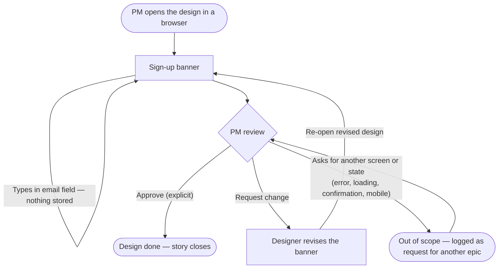

# QA20261110-4 — Static sign-up banner — Structure

Story: QA20261110-4 · Epic: QA-20261110-S5 Sign-up banner design (QA20261110-3) · PRD: https://roeeoz.atlassian.net/wiki/pages/viewpage.action?pageId=35160065 · Traces R1–R5, RK1, RK2.

The design is the deliverable: one static, desktop-only banner screen. Nothing is built, sent or stored (R3, PRD §8).

## Personas

### Product manager of play1 (primary — the only real user)

- **Who**: The person who opens the delivered design in a browser, reviews it and approves it or asks for a change (PRD §1.2, §3; story).
- **Needs**:
  - Open the design in a browser like play1's earlier static design screens, and see one screen with exactly three elements: headline, one email field, a "Sign up" button (R1, R2, AC1).
  - Confirm the design is static — clicking "Sign up" keeps the same screen and sends nothing (R3, AC2).
  - See only sample text in the email field (e.g. `name@example.com`), never a real person's address (R4, AC3).
  - See a license noted for any third-party font, icon or image (R5, AC5).
  - Approve explicitly, or request a change and review the revised design (AC7).
- **Pain points**:
  - No brand, colour or accessibility rules exist, so review risks turning on personal taste (RK2, Q2).
  - Scope creep — error, loading, confirmation or mobile variants would break the "one story, one screen" intent (RK1, AC4).

### Visitor (depicted only)

- **Who**: The site visitor the banner is drawn for. The PRD states no real visitor meets the banner in this epic (PRD §1.2).
- **Needs**: Understand the single message and the one call to action at a glance.
- **Pain points**: None in scope — the visitor does not interact with anything real here. Listed only so the design is read from their point of view.

## User interaction

Ovals and the diamond are review steps, not screens. The only screen is **Sign-up banner**. There are no error, loading or empty states in this story: the banner never submits, so it cannot fail, load or be empty (R3, AC4, PRD §8).

## Screen inventory

| Screen | Purpose | Main elements | States | Based on |
|---|---|---|---|---|
| **Sign-up banner** | Show the PM what the static sign-up banner looks like, so they can approve it (R1). | Exactly three elements (R2, AC1): **headline** — copy set in the design (Q1); **email field** — one input with sample placeholder `name@example.com`, no real address (R4, AC3); **"Sign up" button** — click keeps the same screen, sends nothing, navigates nowhere (R3, AC2). Desktop viewport only. Style starts from play1's approved earlier design tokens (`play1-79db628f23/stories/215fd057/design/screens/tokens.css` — system font stack, no third-party fonts, icons or images, so R5 needs no license note). | **Default** — the only state. **Loading** — none (out of scope, AC4). **Error** — none (out of scope, AC4). **Empty** — n/a; the field shows the sample placeholder. | new |

## Open branches

1. **Headline copy (PRD Q1).** No wording was given. Working choice: the design proposes a short headline (e.g. "Get product updates in your inbox"), and the PM approves or changes it at review. Do you have wording you want instead?
2. **Brand, colour and accessibility rules (PRD Q2, RK2).** None exist in the sources. Working choice: reuse the tokens of play1's approved sign-up design (story 215fd057) and keep text/button contrast at WCAG AA. Are there rules the banner must follow instead?
3. **Banner placement.** A banner is a strip on a page, but the story asks for one screen. Working choice: the banner sits alone, centred on a plain desktop page — no surrounding site chrome, which would add elements beyond R2's three. Confirm that is acceptable.
