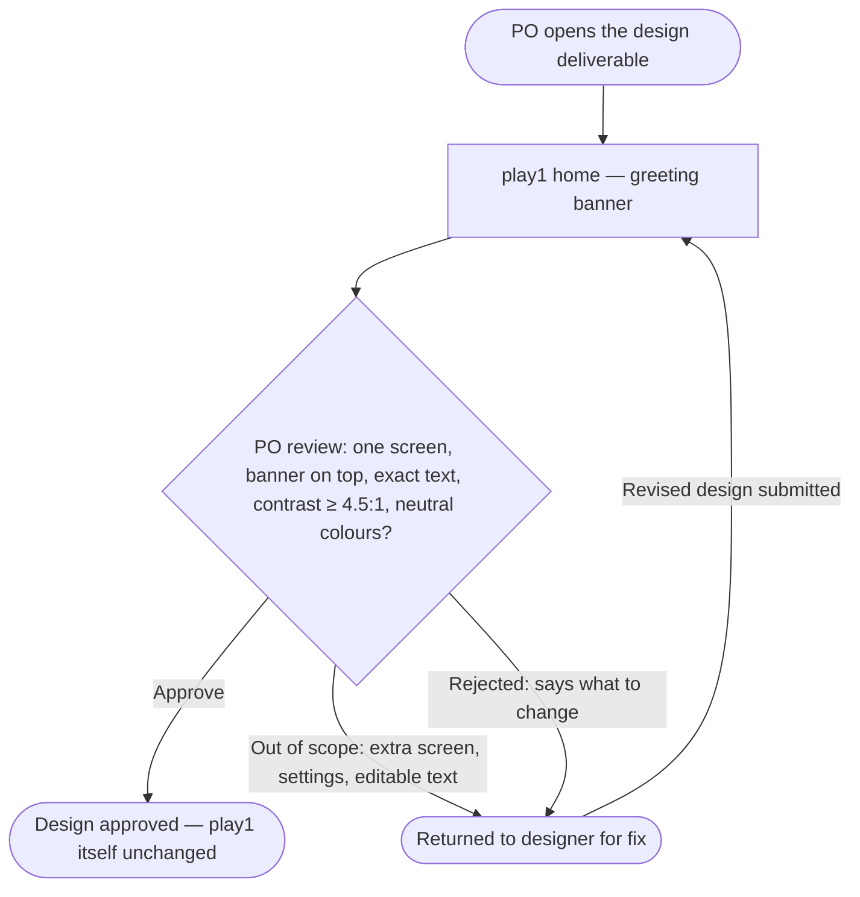

# play1 greeting banner — Structure

Story: QA20261111-3 · Epic: QA20261111-2 · Requirements R1–R5 · Risks RK1, RK2

Today play1 has no UI home page: the checkout holds only Python utilities (`src/testbed_utils/`), shell scripts and a JSON-only guestbook API (`src/guestbook/app.py`, routes `/api/guestbook/entries`). Nothing renders HTML, so the one screen in this story is `new`.

## Personas

### Product owner running platform QA ("Ally PO & DEV" — PO role)

- **Who**: The product owner who runs Halo's quality checks against play1 and is the approval gate for this design.
- **Needs**: Open one design deliverable and confirm, at a glance, that it shows the play1 home page with the banner "Hello from play1" on top (R1, R2), and nothing more (R3).
- **Pain points**: Does not want to write the banner copy or pick colours themselves (PRD §3: "use sensible defaults"); scope creep — extra screens, settings or a dev story — would break what the epic is meant to test (RK1).

### Developer running platform QA ("Ally PO & DEV" — DEV role)

- **Who**: The developer who runs the same QA flow alongside the PO and checks the deliverable against the requirements.
- **Needs**: A deliverable whose contrast (≥ 4.5:1) and screen-reader landmark can be verified (R4), with neutral, muted colours (R5).
- **Pain points**: A design that invents a full home page instead of focusing on the banner (RK2) makes the check ambiguous.

> The future home-page visitor (PRD §3, step 3) is outside this epic and is not a persona here.

## User interaction

The journey has a single screen. The decision node and the end points are the PO's review steps (PRD §3), not screens. The banner is static text: there is no input, no data loading and no list, so the screen has no loading, error or empty state.

## Screen inventory

| Screen | Purpose | Main elements | States | Based on |
|---|---|---|---|---|
| **play1 home — greeting banner** | Show the play1 home page with the greeting banner above all other content (R1–R5) | 1. Greeting banner, full width, first element on the page: text exactly `Hello from play1` in English, no other text, no buttons or links, no dismiss or edit control; marked as a landmark region labelled as a greeting for screen readers; neutral, muted background with text contrast ≥ 4.5:1. 2. Basic home page area below the banner: neutral placeholder only (e.g. page title "play1" and blank content blocks), explicitly not a detailed content design (RK2, AC 7). | Default only (loading / error / empty: not applicable — static content) | new |

## Open branches

1. **Content below the banner** — the PRD only says "basic home page". Simplest option, used unless you say otherwise: a page title "play1" and neutral grey placeholder blocks, with no navigation, header or footer. Do you want anything else shown (or nothing at all under the banner)?
2. **Banner behaviour** — the sources are silent on dismissing the banner. Simplest option, used unless you say otherwise: static, with no close button, since any control would add interaction the scope (R3) does not ask for. Confirm?
