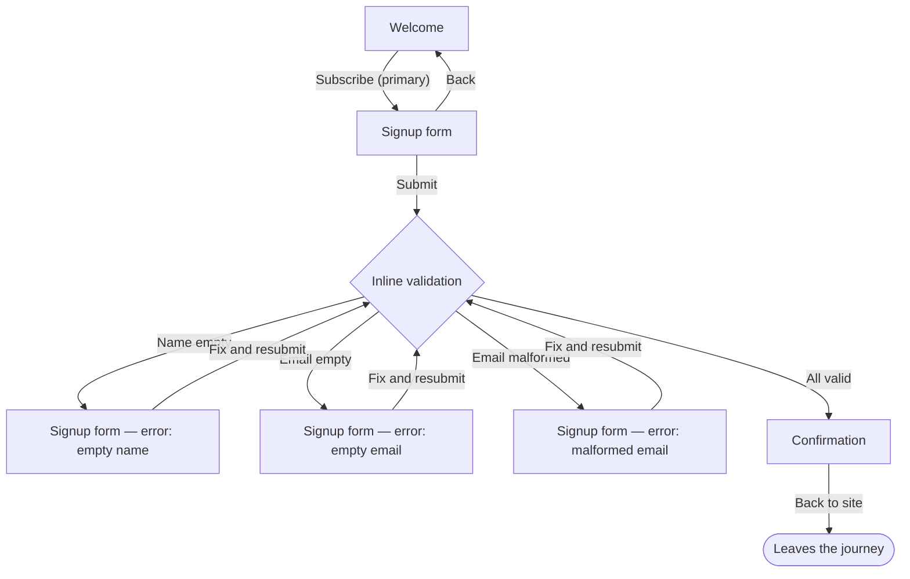

# Newsletter signup journey — Structure

Story: SCRUM-102 (epic SCRUM-101, Newsletter signup). Traces to R1–R4. In scope: the welcome, form and confirmation screens, on desktop and mobile, with their error states. Out of scope: storing the signups and exporting them.

## Personas

### Site visitor (the only persona in the story)

- **Who**: Someone on the site who wants to subscribe to the newsletter, using a desktop or a mobile device.
- **Needs**: A short, clear journey that takes less than a minute on any device. They need to know what they are signing up for, enter only their name and email, and see right away that it worked.
- **Pain points**:
  - Unclear errors, or errors shown only after the page reloads.
  - Forms that are cramped or hard to tap on a phone.
  - Low contrast or an illogical focus order, which shuts out keyboard and screen-reader users (AC 3: WCAG 2.1 AA).

## User interaction

- If several fields fail at once, every inline error shows together on the form. On submit, focus moves to the first field in error.
- Every screen is drawn at desktop and mobile widths (AC 1).
- What happens if the save fails after valid input is an open branch (1). Storing the signups is out of scope.

## Screen inventory

| Screen | Purpose | Main elements | States (default / loading / error / empty) | Based on |
|---|---|---|---|---|
| Welcome | Say what the newsletter is and invite the visitor to subscribe | Headline; one or two lines about the newsletter; primary button "Subscribe" (teal #0F766E with white text, full width on mobile) | default only. Static page, so loading, error and empty don't apply | new |
| Signup form | Collect the name and email | Visible labels "Name" and "Email" (not placeholders alone); primary button "Subscribe" (teal #0F766E, white text, full width on mobile); Back link to Welcome. Focus order: Name → Email → Subscribe → Back | default: empty fields. error: the three rows below. empty: same as default. loading: open branch 1 | new |
| Signup form — error: empty name | Show that the name is required | Inline message under Name, linked to the field (`aria-describedby`), with an icon plus text so colour isn't the only cue; the entered email is kept | error | new |
| Signup form — error: empty email | Show that the email is required | Inline message under Email, styled the same way; the entered name is kept | error | new |
| Signup form — error: malformed email | Show that the email is not a valid address | Inline message under Email, e.g. "Enter an email like name@example.com"; the input is kept for correction | error | new |
| Confirmation | Confirm the signup and give a way back | Heading; one line confirming the subscription; "Back to site" action | default only. Static, no loading, error or empty | new |

## Open branches

1. **What does the form show if the signup can't be saved after valid input?** The story covers only the three inline errors (AC 2), and storing signups is out of scope. My recommendation is not to design a loading or submission-failed state in this story and to go straight from valid input to Confirmation, because that is exactly what the acceptance criteria ask for. Choose to add a "Signup form — submission failed" state (banner, input kept, retry) if the storing story will not provide one.
2. **Do the welcome and form screens stay separate, or merge into one?** The story names three screens, so I keep them separate. Merging them would shorten the journey on mobile, but it would contradict AC 1. Change this only if you'd rather have speed than the three-screen structure.
3. **Copy and the Confirmation exit.** The sources give no wording and no destination. I recommend the heading "You're subscribed", the line "Thanks, {name}. We'll send the newsletter to {email}.", and "Back to site" linking to the home page. Showing the address lets the visitor catch a typo. Replace with approved copy if marketing has it.
