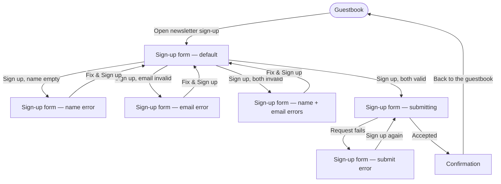

# SCRUM-108 — Guestbook newsletter sign-up — Structure

Two new screens: `Sign-up form` and `Confirmation`. The repo has a guestbook JSON API (`src/guestbook/app.py`, entries only) but no guestbook UI and no newsletter endpoint, so both screens are `new`.

## Personas

### Guestbook visitor

- **Who**: A visitor of the guestbook (the story's only user).
- **Needs**: Sign up for the guestbook newsletter with just a name and an email; see right away that it worked, with the details they entered.
- **Pain points**: Not knowing whether a sign-up went through; finding out about a typo (empty name, bad email) only after submitting with no clear pointer to the field; being stranded after signing up with no way back to the guestbook.

## User interaction

`Guestbook` is the exit/entry point outside this story (no UI exists for it yet); it is not a screen of this flow.

## Screen inventory

| Screen | Purpose | Main elements | States | Based on |
|---|---|---|---|---|
| Sign-up form | Collect name and email for the guestbook newsletter | Title, short line on what the newsletter is, `Name` field, `Email` field, `Sign up` button, inline error text under each field | **default**: empty fields, button enabled · **loading**: button disabled with "Signing up…", fields read-only · **error**: inline "Please enter your name" under Name (empty / whitespace-only), inline "Please enter a valid email" under Email; both can show at once; focus moves to the first invalid field; entered values are kept · **error (submit)**: form-level message "Sign-up didn't go through. Please try again." above the button, values kept · **empty**: n/a (the default state is the empty form) | new |
| Confirmation | Tell the visitor the sign-up worked | Heading "Thanks, {name}!", line "We'll send the newsletter to {email}.", `Back to the guestbook` link | **default**: name and email from the submitted form · **loading**: n/a (shown only after success) · **error**: n/a · **empty**: n/a (unreachable without a successful submit; a direct visit should send the visitor to the form) | new |

## Open branches

1. **Where does the sign-up go?** No newsletter endpoint exists (the guestbook API only stores entries). Drafted as a submit that can succeed or fail, with the `submitting` and `submit error` states. If the designer wants a pure client-side prototype with no request, those two states drop out and `Sign up` goes straight to `Confirmation`.
2. **Where does "Back to the guestbook" link to?** There is no guestbook page today. Drafted as a link to a placeholder guestbook URL (`/`).
3. **When does inline validation fire?** Drafted as on `Sign up` (then re-checked as the visitor edits a flagged field) — the simplest behaviour that matches "inline validation". Validating on blur is the alternative.
4. **Already-subscribed email**: the story is silent; drafted as treated like a new sign-up (same `Confirmation`), which keeps the flow at two screens.
