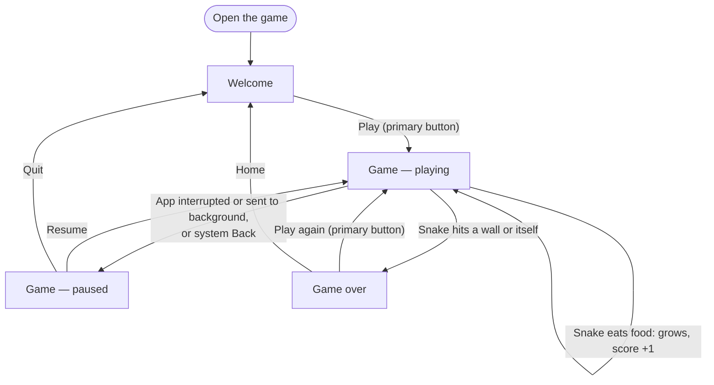

# Snake game for mobile — Structure

Story: SCRUM-113. A simple snake game for a mobile phone, played on long drives. Three screens: Welcome (AC 1), Game with a snazzy looking snake (AC 2), Game over (AC 3). None of them exists in any checkout, so all three are `new`.

## Personas

### Gamer on a long drive

- **Who**: A gamer who plays on their mobile phone to pass time on long drives. The story names only this user.
- **Needs**: A game they can pick up in seconds with no setup. It should look good ("snazzy" snake), and a round that ends should go straight into another one.
- **Pain points**: Long drives get boring. A game with a complicated start, or one that ends without an obvious way to play again, defeats the purpose of a quick, simple game.

## User interaction

The game runs on the phone and loads nothing, so no screen has a loading, error or empty state. "Game — paused" is a state of the Game screen, not a separate screen.

## Screen inventory

| Screen | Purpose | Main elements | States | Based on |
|---|---|---|---|---|
| **Welcome** | Show what the game is and start a round in one tap | Game title; a snazzy snake visual matching the Game screen; one line explaining how to steer (swipe); **Play** primary button (teal #0F766E, white text, full-width on mobile) | **default** only. Loading, error and empty don't apply because nothing is fetched | new |
| **Game** | Play: steer the snake to eat food and grow without crashing | Play field with its edges visible; the snake, styled to look snazzy (e.g. gradient body, distinct head with eyes); food item; current score; pause button | **playing** (default). **paused**: overlay over the frozen board with **Resume** (primary) and **Quit**; entered by the pause button, by an interruption (call, app sent to background) or by system Back. Loading, error and empty don't apply | new |
| **Game over** | End the round, show the result, and offer the next round | "Game over" heading; final score for the round; **Play again** primary button (teal #0F766E, white text, full-width on mobile); **Home** secondary link back to Welcome | **default** only | new |

## Open branches

1. **How does the player steer?** The story doesn't say. Options: (a) swipe anywhere on the board, (b) on-screen arrow buttons, (c) both. I recommend (a) swipe: it keeps the whole screen for the board and matches the "simple" goal. Pick (b) or (c) if players should be able to steer precisely with one thumb.
2. **Keep a best score across rounds?** The story asks for a score only implicitly, through the Game over screen. I recommend showing only the score of the round just played, the simplest version that gives Game over a result to show. Choose yes if a best score to beat matters for replay on long drives. It would then appear on Game over, and maybe on Welcome.
3. **Is auto-pause on interruption in scope?** The story doesn't mention pausing. I added a paused state because a phone call or switching apps would otherwise kill the snake while the player is away. I recommend keeping it. Drop it if you want exactly the three screens' default states and nothing else.
